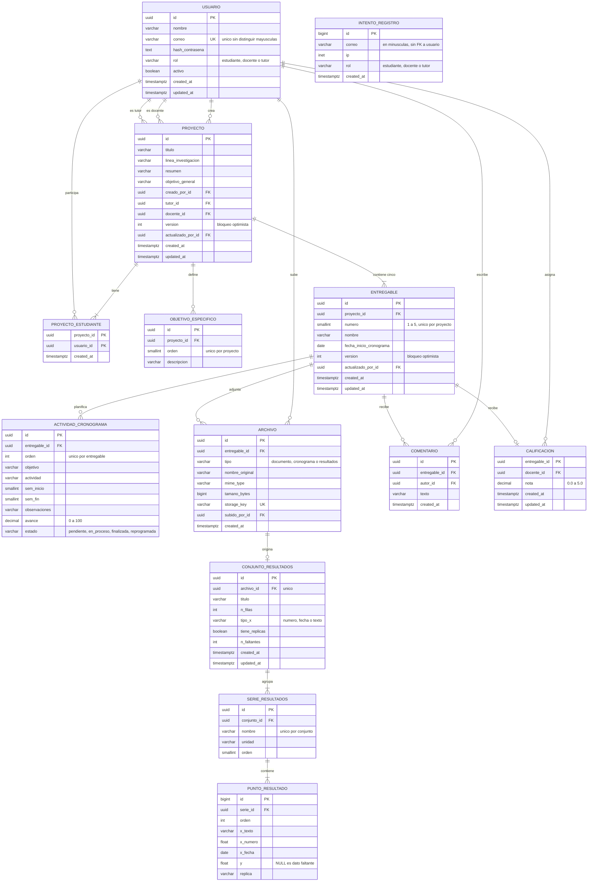
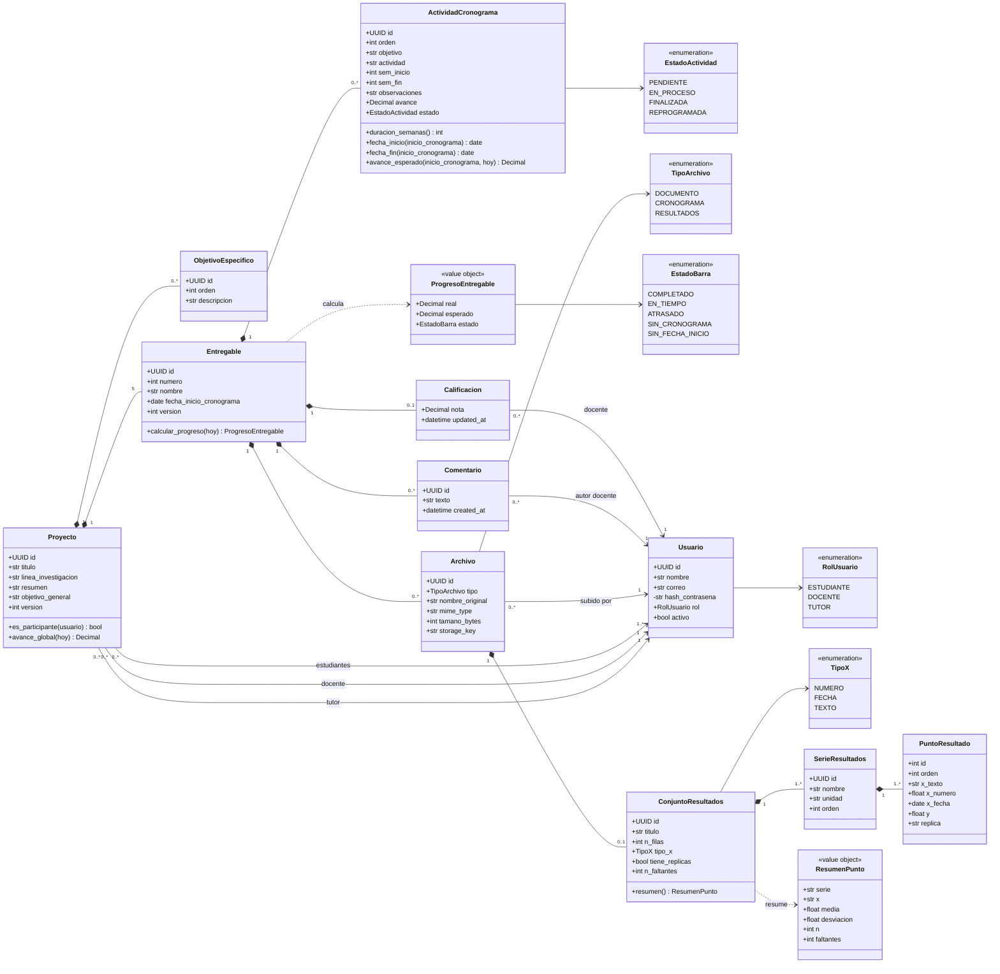

# Modelo de datos y diagrama de clases

| | |
| --- | --- |
| Versión | 0.2. La 0.1 está aprobada; esta agrega la tabla `intento_registro` por el código de registro (D8) |
| Fecha | 2026-10-24 |
| Fuente | [requisitos-funcionales.md](requisitos-funcionales.md) v0.3 |
| Motor | PostgreSQL 17 |
| DDL de referencia | [modelo-de-datos.sql](modelo-de-datos.sql), 13 tablas |
| Pruebas del esquema | [modelo-de-datos.test.sql](modelo-de-datos.test.sql), 75 casos, sección 8 |
| Siguiente paso | Migración Alembic y modelos SQLAlchemy, luego definición de la API |

## 1. Decisiones de diseño (mías, revisar)

| Id | Decisión | Motivo |
| --- | --- | --- |
| M1 | Claves primarias `uuid` (`gen_random_uuid()`), salvo `punto_resultado` con `bigint identity`. | Los ids viajan en URLs y UUID evita enumerarlos. Los puntos son decenas de miles de filas y no se exponen por id. |
| M2 | Enumeraciones como `varchar` + `CHECK`, no como tipo `ENUM` nativo. | Agregar un valor no exige `ALTER TYPE`, y las migraciones de Alembic son más simples. |
| M3 | El rol exigido en cada relación se impone con **FK compuesta** `(id, rol)` hacia `usuario`. Aplica a creador, tutor, docente, estudiantes, autor de comentario, docente que califica y quien sube archivos. | RN-02, RN-04 y RN-07 quedan en la BD, no solo en el código. Efecto secundario probado: el rol de un usuario referenciado no se puede cambiar. |
| M4 | Resultados en tres niveles: `conjunto_resultados` → `serie_resultados` → `punto_resultado`. | La unidad vive en la serie (RN-16) y no se repite en cada fila. |
| M5 | Se guardan las **mediciones individuales**. Media y desviación estándar se calculan al leer con `avg` y `stddev_samp` (n − 1), que ignoran los `NULL`. | RF-RES-13 y RF-RES-12. La consulta está verificada en la sección 6. |
| M6 | No se guardan las fechas de las actividades ni el avance del entregable. Se calculan en una función pura del servicio. | RN-05 y RN-14. Una sola fuente de verdad y fácil de probar. |
| M7 | Los límites configurables (peso, filas, semanas, cantidad de actividades y series) **no** son `CHECK`. Se validan en la API. | S10. Las longitudes `varchar(n)` sí quedan en la BD con los valores por defecto: subirlas exige migración. |
| M8 | Bloqueo optimista con columna `version` en `proyecto` y `entregable`. | S8, RN-09. La regla de incremento está en la sección 6. |
| M9 | `ON DELETE CASCADE` desde `proyecto` hacia abajo. `usuario` queda en `RESTRICT`. | Borrar proyectos está fuera del MVP, pero así no hay huérfanos si se agrega. Los usuarios no se borran, y RN-10 exige que los comentarios conserven su autor. |
| M10 | `y` es `double precision`, no `numeric`. | Los gráficos y las estadísticas trabajan en coma flotante. La BD rechaza `NaN` e infinitos. |
| M11 | Correo único sin distinguir mayúsculas con índice sobre `lower(correo)`. | Evita depender de la extensión `citext`. |
| M12 | Fechas de auditoría como `timestamptz` en UTC. "Hoy" en `America/Bogota` se calcula en el servicio (S13). | |
| M13 | Los códigos de registro **no** van en la BD: un código por rol en la configuración del servidor (D8, RN-19). Lo único que se persiste son los intentos fallidos, en `intento_registro`, sin FK a `usuario` porque el correo puede no existir aún. | Un límite por correo o IP no se puede contar sin guardar los intentos, y la BD sirve a varios procesos a la vez. Una memoria por proceso permitiría saltarse el límite. |

## 2. Diagrama entidad-relación



Las columnas `*_rol` (`tutor_rol`, `docente_rol`, `autor_rol` y similares) no se dibujan. Son constantes que completan la FK compuesta de M3. `INTENTO_REGISTRO` queda aislada a propósito (M13).

## 3. Diagrama de clases

Clases del dominio. Cada clase persistente corresponde a una tabla, salvo `intento_registro`, que es infraestructura de seguridad y no una clase de dominio. Los métodos son lógica de negocio pura, sin acceso a la BD, y se implementan como funciones del dominio. La estructura de módulos se define en el paso siguiente.



## 4. Dónde se aplica cada regla de negocio

**BD** = restricción en PostgreSQL. **Servicio** = lógica de aplicación. Una regla marcada con ambas tiene defensa doble.

| Regla | Mecanismo | Detalle |
| --- | --- | --- |
| RN-01 | BD + servicio | `tutor_id` y `docente_id` son `NOT NULL` con FK. El **mínimo de 1 estudiante** no se puede expresar con restricciones simples: lo garantiza el servicio dentro de la transacción y una prueba. |
| RN-02 | BD | FK compuesta `(tutor_id, tutor_rol)` y `(docente_id, docente_rol)` hacia `usuario(id, rol)`. |
| RN-03 | BD + servicio | `CHECK (numero BETWEEN 1 AND 5)` y `UNIQUE (proyecto_id, numero)` impiden más de 5. Que existan los 5 lo garantiza el servicio creándolos en la misma transacción que el proyecto. |
| RN-04 | BD + servicio | `CHECK (nota BETWEEN 0.0 AND 5.0)` y FK compuesta con rol docente. Que sea el docente **asignado a ese proyecto** lo valida el servicio. |
| RN-05 | BD + servicio | `CHECK (avance BETWEEN 0 AND 100)` por actividad. El avance del entregable se calcula. |
| RN-06 | BD | `CHECK (sem_inicio >= 1)` y `CHECK (sem_fin >= sem_inicio)`. |
| RN-07 | BD + servicio | FK compuestas: solo un docente comenta y califica, solo un estudiante sube archivos. El resto de la autorización por rol es del servicio. |
| RN-08 | Servicio | Cada consulta filtra por participación del usuario. |
| RN-09 | Servicio | `UPDATE ... WHERE version = :visto`. Ver sección 6. |
| RN-10 | BD | La FK de autor no tiene `CASCADE` ni `SET NULL`. Los comentarios conservan al docente anterior. |
| RN-11 | Servicio | Validar, guardar el archivo e importar las filas en una sola transacción. |
| RN-12 | n/a | No existe columna de nota definitiva. |
| RN-13 | BD | `CHECK ((estado = 'finalizada') = (avance = 100))`. |
| RN-14 | Diseño | Las fechas de actividad no se guardan. Se derivan en el servicio. |
| RN-15 | BD | `UNIQUE NULLS NOT DISTINCT (serie_id, x_texto, replica)`. Sin réplica, `(serie, x)` también es único. |
| RN-16 | BD + servicio | La unidad es columna de `serie_resultados`. Detectar varias unidades en un archivo lo hace el importador. |
| RN-17 | n/a | Solo se valida estructura. |
| RN-18 | BD | La FK compuesta (M3) deja el rol inmutable mientras el usuario esté referenciado. Que el rol salga de un código válido lo garantiza el servicio al registrar. |
| RN-19 | Servicio | Los códigos viven en la configuración del servidor, no en la BD. El servicio rechaza el registro de un rol sin código configurado. |
| RN-20 | BD + servicio | `intento_registro` guarda cada fallo. El servicio cuenta la ventana de 15 minutos por correo o IP. Ver sección 6. |
| S7 | BD | Índice único parcial: un `documento` y un `cronograma` vigentes por entregable. Los `resultados` son varios. |

## 5. Tablas y requerimientos

| Tabla | Requerimientos que respalda |
| --- | --- |
| `usuario` | RF-AUT-01 a 06, RF-PRY-02 |
| `proyecto`, `proyecto_estudiante`, `objetivo_especifico` | RF-PRY-01 a 07, RF-INF-01 a 06 |
| `entregable` | RF-ENT-01 a 05, RF-CRO-02 |
| `actividad_cronograma` | RF-CRO-01, 03 a 08, 10 a 12 |
| `archivo` | RF-ENT-03, RF-CRO-01, RF-RES-01, RF-ARC-01 a 05 |
| `conjunto_resultados`, `serie_resultados`, `punto_resultado` | RF-RES-02 a 13 |
| `comentario`, `calificacion` | RF-EVA-01 a 06 |
| `intento_registro` | RF-AUT-09 |

## 6. Convenciones para la implementación

**Incremento de versión (bloqueo optimista).** Cualquier cambio en la información general **incluye** objetivos específicos y participantes aunque vivan en otras tablas. Una sola sentencia lo decide:

```sql
UPDATE proyecto
   SET version = version + 1, updated_at = now(), actualizado_por_id = :usuario
 WHERE id = :id AND version = :version_visto;
-- 0 filas afectadas => responder 409 con el estado actual
```

Lo mismo con `entregable` para: fecha de inicio del cronograma, edición de actividades y reimportación. Documento y resultados no usan bloqueo: reemplazar es una operación completa.

**Restricciones diferidas.** `uq_objetivo_orden` y `uq_actividad_orden` son `DEFERRABLE INITIALLY DEFERRED` para poder reordenar intercambiando valores en un `UPDATE`. Un orden duplicado se detecta **en el `COMMIT`**, no en la sentencia. En SQLAlchemy el `IntegrityError` aparece al confirmar, no en `flush()`.

**Reimportar el cronograma.** En una transacción: `DELETE` de las actividades del entregable, `INSERT` de las nuevas, incremento de versión del entregable.

**Reemplazar un archivo.** En una transacción: `DELETE` de la fila anterior y `INSERT` de la nueva (en ese orden, por el índice único parcial). El archivo físico anterior se borra **después** del commit.

**Resumen de resultados.** Media, desviación estándar muestral, n y faltantes por serie y `x` (verificado: 45,11 ± 5,98 con n = 3, y desviación nula con n = 1):

```sql
SELECT s.nombre AS serie, p.x_texto AS x,
       avg(p.y)         AS media,
       stddev_samp(p.y) AS desviacion,
       count(p.y)       AS n,
       count(*) - count(p.y) AS faltantes
  FROM punto_resultado p
  JOIN serie_resultados s ON s.id = p.serie_id
 WHERE s.conjunto_id = :conjunto
 GROUP BY s.id, s.nombre, s.orden, p.x_texto
 ORDER BY s.orden, min(p.orden);
```

**Límite de intentos de registro (RF-AUT-09).** Solo se insertan los intentos **fallidos**; un código correcto no deja fila. Antes de comparar el código, el servicio revisa el bloqueo con una consulta por ventana deslizante. Si devuelve una fila, el registro está bloqueado y la fila indica cuándo se libera (verificado: el tiempo de espera sale en cerca de 1 minuto cuando el quinto intento más reciente tiene 14 minutos):

```sql
SELECT created_at + interval '15 minutes' AS se_libera_a
  FROM intento_registro
 WHERE (correo = :correo OR ip = :ip)
   AND created_at > now() - interval '15 minutes'
 ORDER BY created_at DESC
OFFSET 4 LIMIT 1;
-- una fila => bloqueado hasta se_libera_a (responder 429); sin filas => puede intentar
```

El correo se guarda en minúsculas (hay un `CHECK`), con o sin cuenta existente. Si la IP no se conoce (detrás de un proxy sin cabecera confiable) queda `NULL` y solo cuenta el correo. Los intentos de más de un día se borran con un `DELETE` periódico; no hace falta nada más porque la ventana es de 15 minutos.

**Mapeo a SQLAlchemy 2.** Todo se expresa de forma declarativa y se refleja en la migración Alembic:

| Necesidad | Construcción |
| --- | --- |
| FK compuesta de rol | `ForeignKeyConstraint(["tutor_id", "tutor_rol"], ["usuario.id", "usuario.rol"])` |
| Constante de rol | `Column(String(10), nullable=False, server_default="tutor")` más `CheckConstraint` |
| Único con `NULL` | `UniqueConstraint(..., postgresql_nulls_not_distinct=True)` |
| Único parcial | `Index(..., unique=True, postgresql_where=text("tipo IN ('documento', 'cronograma')"))` |
| Restricción diferida | `UniqueConstraint(..., deferrable=True, initially="DEFERRED")` |
| `updated_at` | `onupdate=func.now()` en el modelo |

## 7. Fuera de la migración inicial

- **`historial_avance`** (RF-CRO-13, prioridad Could): `id`, `actividad_id`, `valor numeric(5,2)`, `usuario_id`, `created_at`. Se agrega con su propia migración si se aprueba.
- **Índices adicionales:** revisar con datos reales. Hoy hay índices para las consultas de "Mis proyectos", listado de usuarios por rol, comentarios por entregable y lectura de puntos por serie.
- **Trigger de las 5 entregables o del mínimo de estudiantes:** descartados por ahora. Viven en el servicio, con prueba.

## 8. Verificación

El DDL se cargó en un PostgreSQL 17 limpio y se corrieron 75 casos que ejercitan cada restricción: 73 aparecen como PASS en el informe y 2 son rechazos del `COMMIT` diferido (orden duplicado de objetivos y de actividades) que psql muestra como `ERROR` y no entran al informe.

Cubre: correo duplicado sin distinguir mayúsculas, roles incorrectos en tutor, docente, creador, estudiantes, autor de comentario, quien sube archivos y quien califica; inmutabilidad del rol de un usuario referenciado; `numero` del entregable fuera de 1 a 5 o repetido; las reglas de actividad (semanas, avance, `Finalizada ⇔ 100`, estado inválido); un solo documento vigente y varios resultados por entregable; un conjunto de resultados sobre un archivo de tipo incorrecto; réplicas únicas con y sin `NULL`; `NaN` e infinito en `y`; nota fuera de rango y calificación única; el borrado en cascada sin filas huérfanas; y los intentos de registro (correo en minúsculas, rol e IP válidos, ventana deslizante de 15 minutos por correo y por IP, tiempo de espera y purga).

Para reproducirlo:

```bash
docker run -d --rm --name pgtest -e POSTGRES_PASSWORD=x postgres:17-alpine
docker cp docs/modelo-de-datos.sql pgtest:/tmp/schema.sql
docker cp docs/modelo-de-datos.test.sql pgtest:/tmp/test.sql
docker exec pgtest psql -U postgres -v ON_ERROR_STOP=1 -q -f /tmp/schema.sql
docker exec pgtest psql -U postgres -f /tmp/test.sql
docker rm -f pgtest
```

En Git Bash en Windows, anteponer `MSYS_NO_PATHCONV=1` a los `docker exec` para que no reescriba las rutas `/tmp`.
